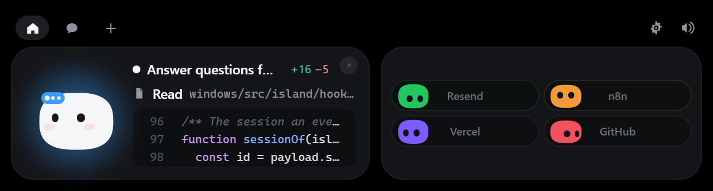

# Coucou

Mochi, a tiny animated island at the top of your Windows screen to follow and approve Claude Code sessions

[](LICENSE)



> Fork of [Louis-CFM/coucou](https://github.com/Louis-CFM/coucou) by Louis Raillé.
> This fork is the Windows-only, modular build: a small always-on core plus optional modules (Claude Code, media, upload, timer, voice and one per service such as GitHub, Vercel, Stripe, n8n, Resend, Cal.com, Notion), with extra work on full-screen detection, Claude Code approvals and the herdr terminal integration.

## Features

- Show Claude Code sessions on a small island with Mochi, an animated character
- Approve permissions and answer questions from the island, only on an explicit click
- Drop a file on the island to open it in a Claude Code session, or drag Mochi onto a window to attach a screenshot
- Add read-only service pills (GitHub, Vercel, Stripe, n8n, Resend, Cal.com, Notion) by switching modules on
- Hide over full-screen apps and calls; mouse back/forward buttons navigate the open island
- Run with no telemetry, no account and no Anthropic API key

## Tech stack

- Tauri 2 (Rust backend in `windows/src-tauri/`)
- TypeScript frontend built with Vite (`windows/src/`)
- `coucou-hook`, a small Rust relay called by Claude Code hooks
- Tests with `node --test` and Vitest

## Getting started

### Prerequisites

- Windows 10 or 11
- Node 20+
- Rust toolchain with MSVC build tools

### Install

```powershell
git clone https://github.com/joao-carmassi/coucou.git
cd coucou/windows
npm install
npm run tauri dev      # development build
npm run pack           # installer in windows/release/
```

## Usage

Open the tray icon, then **Settings**.

- **Claude Code:** *Install hooks* shows the diff, makes a dated backup of `settings.json` and writes only after you click. If Coucou is not running, the hook exits at once, so Claude Code is never blocked.
- **Services:** switch a service module on and paste its token. Tokens go to Windows Credential Manager.

Move the mouse to the top-centre of the screen to wake Mochi, click the island to open it, `Esc` to close. See [windows/README.md](windows/README.md) for all interactions and modules.

## Configuration

Modules are switched on or off in Settings. Module API and status: [docs/MODULES-CONTRACT.md](docs/MODULES-CONTRACT.md). Behaviour: [docs/SPEC.md](docs/SPEC.md). Hooks and service modules: [docs/INTEGRATIONS.md](docs/INTEGRATIONS.md).

## Credits

- [Coucou](https://github.com/Louis-CFM/coucou) by Louis Raillé: the original app, the Mochi character, icon, sounds and the screenshot above.
- Name, Mochi character, icon, sounds and media are (c) Louis Raillé, all rights reserved, see [LICENSE-ASSETS.md](LICENSE-ASSETS.md).

## License

Code licensed under upstream's MIT license - see [LICENSE](LICENSE).

---
Made by [João Carmassi](https://github.com/joao-carmassi)
