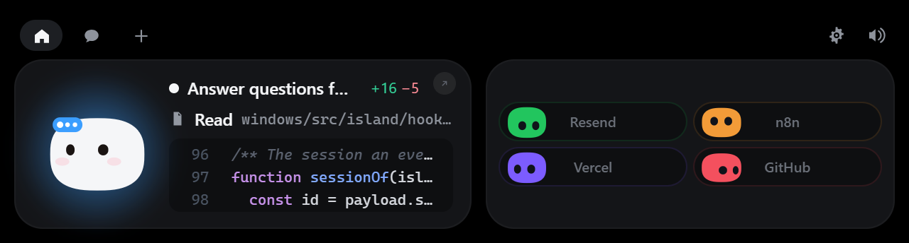
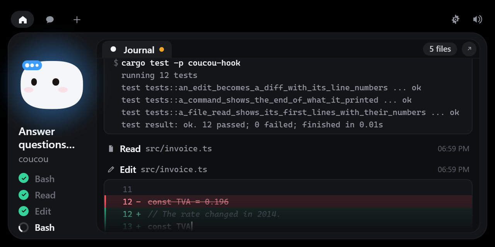
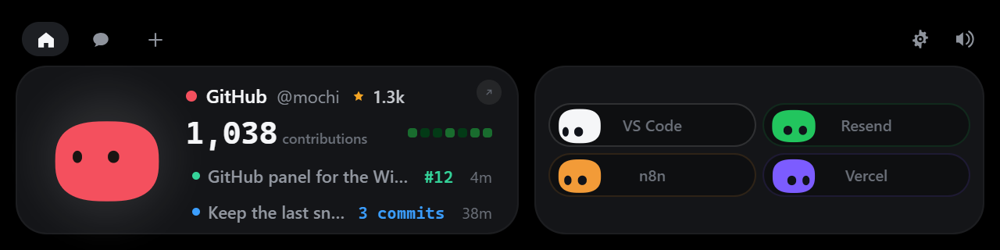
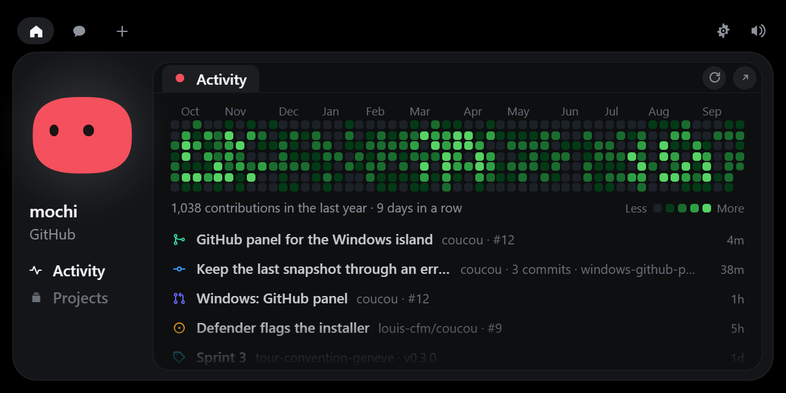

<div align="center">


# Coucou for Windows

**Mochi lives at the top of your screen: approve Claude Code, drop a file, keep an eye on your services.**


</div>


---

Windows only. No chat of its own, no Anthropic API key, no telemetry. The **core**
is the island and Mochi; everything else is a **module** you can switch on or off.

## Install

The downloadable installer is temporarily unavailable: Microsoft Defender wrongly
flags the unsigned installer. Until it is cleared and signed, [build it
yourself](#build-it-yourself). It installs for the current user only, with no
admin prompt.

## Using it


| What you do | What happens |
|---|---|
| Move the mouse to the very top-centre of the screen | Mochi peeks out |
| Click the small island | It opens |
| Click Mochi | It gets annoyed. Three times in a row and it goes dizzy |
| Rest the pointer on Mochi for two seconds | Hearts |
| Drag a file onto the island | Upload module: Mochi turns into a box and swallows it |
| Drag Mochi onto a window | A screenshot of that window is captured and attached |
| `Esc` | Closes the island |
| Tray icon | Abrir Coucou, Configurações…, Pausar, Sair |

**Idle behaviour:** after you leave the island it closes by itself, then
minimises, then hides (the delays are in Settings; hiding can be set to never).
Hidden, it costs about nothing: a disabled module creates no thread, timer or
listener, and an enabled one only runs while it has work to do. See
[`docs/idle-baseline.md`](../docs/idle-baseline.md).

## Settings and modules

Tray → **Configurações…**. **Geral** has sound, auto-close and auto-hide delays,
which screen the island sits on and start with Windows. **Módulos** has one switch
per module; a disabled module has no tab, view, pill, timer, thread or listener.

| Module | Default | What it does |
|---|---|---|
| Painel (`board`) | on | The **Início** tab: the focused pill's card and the list of the others. Needs nothing; every module's pills use it |
| Claude Code (`claude`) | on | Hooks, sessions, approvals, questions, Sessions tab |
| Mídia (`media`) | on | Screenshots, game-bar clips and dropped files in a grid |
| Timer (`timer`) | off | Countdown (1 to 600 min) or stopwatch, shown as a pill |
| Soltar arquivo (`upload`) | on | Drop a file, open it in Claude Code. Needs `claude`; under **Claude** |
| Voz (`voice`) | off | Speech to a new Claude Code session. Needs `claude`; under **Claude** |
| GitHub, Vercel, Stripe, n8n, Resend, Cal.com, Notion | off | Read-only pills, under **Integrações** |

Turning `claude` off turns `voice` and `upload` off with it; the board and the service modules stay. With the board off, `claude` is home itself. The contract is in
[`docs/MODULES-CONTRACT.md`](../docs/MODULES-CONTRACT.md).

### Hotkeys

| Hotkey | Default | Module |
|---|---|---|
| Voice toggle | `Ctrl+Alt+V` | Voz (empty = none) |
| "Go to alert" | off | Claude Code (e.g. `Ctrl+Alt+A`); jumps to the card waiting for you |

## Claude Code


**Settings → Claude Code → Install hooks…** shows the exact diff for
`%USERPROFILE%\.claude\settings.json` and the path of the dated backup, and writes
nothing until you click. Your own hooks are never touched; uninstalling removes
only Coucou's entries. Other profiles (`~/.claude-*`) get their own row, and an
optional account folder can be set for the Sessions tab.

The relay, `coucou-hook.exe`, is copied to `%LOCALAPPDATA%\Coucou\bin\`. It has
300 ms to reach Coucou and exits cleanly if the app is closed or slow, so a Claude
Code session is never blocked. If nobody answers a permission request in time,
Claude Code asks in the terminal as usual. Hooks use Claude Code's exec form (no
shell involved). It works from the Claude desktop app, VS Code, Windows Terminal,
PowerShell and Git Bash. **Settings → WSL** installs the same for a WSL
distribution ([`hook/coucou-hook-wsl.sh`](hook/coucou-hook-wsl.sh)).


- **Approvals:** a permission request opens the island with **Deny / Allow**; an
  edit shows its diff first.
- **Questions:** Claude's questions show their options on the island; pick,
  type your own, or hand it back.
- **Aguardar:** closes the island and leaves the request pending, with no
  decision sent. Answer later or in the terminal.
- **Card and panel:** the card shows the step under way and then **Done** with
  Claude's reply. Click it for the session panel and its journal (reads, diffs,
  commands, questions, permissions). The island only watches; to write to Claude,
  use Claude Code.




- **Several sessions:** up to four are followed; a chip opens the list.
- **Sessions tab:** every Claude Code session of every profile, from
  `<config dir>/projects`. Start a new one, resume an offline one or focus a
  running terminal.

Everything comes from the hooks. The relay forwards only a few lines of tool
output; the journal (last 80 lines) lives in memory and nothing of it goes to the
log. The relay reads from disk only the file an edit asks permission for (to show
its diff) and the end of the session transcript (title and last message).

## Mídia, upload, timer, voice

- **Mídia:** lists what Windows saved (`Pictures\Screenshots`, `Videos\Captures`)
  and what came onto the island, newest first. Files are never copied by the
  list, and removing an entry never deletes the file.
- **Upload:** a dropped file is copied to `%LOCALAPPDATA%\Coucou\inbox` (swept after
  a week) and **Abrir no Claude Code** starts a new session with it attached.

  

- **Timer:** pick minutes (or a stopwatch), then **Iniciar**. A sound and a note
  mark the end.
- **Voice:** English only. The hotkey opens the microphone and it keeps recording through
  silence until you end it: press the hotkey again or **Enter** (**Esc** cancels and drops the
  audio). There is no silence or no-speech auto-stop; the only automatic stop is a hard safety cap of
  10 minutes so a forgotten recording cannot grow forever. `needle.exe` with the `whistle.cact` model
  (Cactus, telemetry off) transcribes it on your PC, and the text appears inline
  on the same voice card that showed "listening" (no separate review page), with no timer:
  **Enter** opens a new Claude Code session with it, **Esc** drops it, **Aguardar** hides the island
  but keeps the transcript (hover the island or press the hotkey to bring the card back; the island
  is not kept awake and no timer runs while it waits). The island takes focus and listens for
  Enter/Esc only while listening or while the card is showing. The
  model (~20 MB) is downloaded only from the button **Baixar modelo** in Settings →
  Voz, from huggingface.co, pinned and SHA-256 checked, into `%LOCALAPPDATA%\Coucou\voice`.

## Integrations and keys

GitHub, Vercel, Stripe, n8n, Resend, Cal.com and Notion each have a switch and a
key field under **Settings → Integrações**, and show as coloured pills next to
Mochi. They only read. Per-service details (token permissions, polling rates):
[`docs/INTEGRATIONS.md`](../docs/INTEGRATIONS.md). GitHub also has its own panel.




Keys live in the **Windows Credential Manager**, never on disk or in the log, and
the interface can only ask whether a key exists; every request is made by the Rust
side. Settings are in `%APPDATA%\Coucou\settings.json`. The log is
`%LOCALAPPDATA%\Coucou\coucou.log` (restarts past ~1 MB, stays on your machine).

No telemetry. Network requests go only to the services you configure and, once,
to huggingface.co if you download the voice model.

## Build it yourself

You need [Rust](https://rustup.rs), [Node 20+](https://nodejs.org) and the MSVC
build tools ("Desktop development with C++"). WebView2 ships with Windows 10/11.

```powershell
cd windows
npm install
npm run tauri dev      # live-reloading development build
npm run pack           # builds the installer into windows/release/
```

`npm run pack` leaves `Coucou-Windows-X.Y.Z-setup.exe` and
`Coucou-Windows-setup.exe` (same file, rolling name) in `windows/release/`.
`npm run dev` alone serves the front end in a browser. `npm run icons`
regenerates the icons. Sounds live in `windows/sounds/`.

Checks before a commit:

```powershell
npx tsc --noEmit && npm run build && npm test && npm run idle-audit
cd src-tauri; cargo check; cargo test
```

`npm run idle-audit` fails on raw timers, top-level listeners or thread spawns in
modules; `scripts/idle-measure.ps1` samples a running Coucou's CPU and threads.

## Project layout

```
src/core/               module API (moduleApi.ts), registry, bridge, layout
src/island/  src/mochi/ island state machine and window; Mochi, Canvas 2D
src/modules/<id>/       claude, media, upload, timer, voice, integrations
src/kit/                shared UI builders and classes (panel, tile, row, diff)
src/modules/<id>/manifest.json  the module list (MODULE_INFO and the Rust CATALOG are generated from it)
src-tauri/src/core/     host.rs (ModuleHost), hotkeys, island, tray, settings, platform/
src-tauri/src/modules/  <id>/mod.rs per module (registry and commands generated by build.rs)
hook/                   coucou-hook.exe, the Claude Code relay
scripts/                pack, icons, idle-audit, idle-measure
```

A module is a folder under `src/modules/<id>` (with a `manifest.json`) and, if it
has native code, a folder `src-tauri/src/modules/<id>` with a `mod.rs`
(`PREFIXES`, `modules()`, `handler()`). Nothing else is edited: `build.rs` and
`import.meta.glob` find it. Core never imports a module. Recipes and rules:
[`docs/MODULES-CONTRACT.md`](../docs/MODULES-CONTRACT.md), `src-tauri/src/modules/README.md`.
